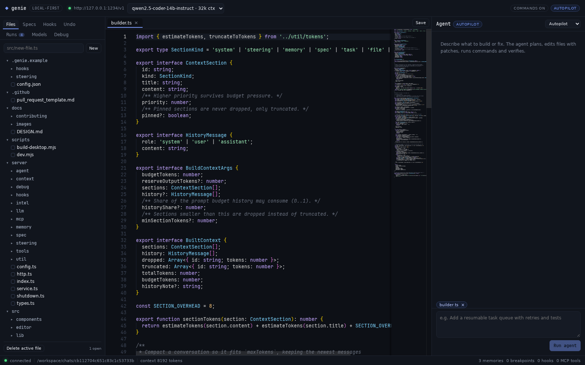
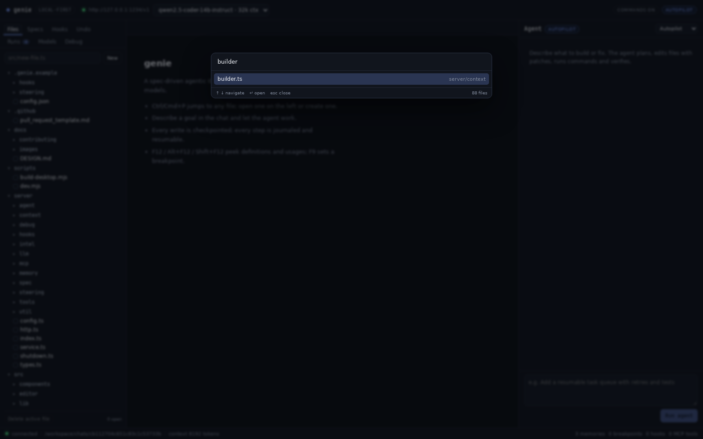
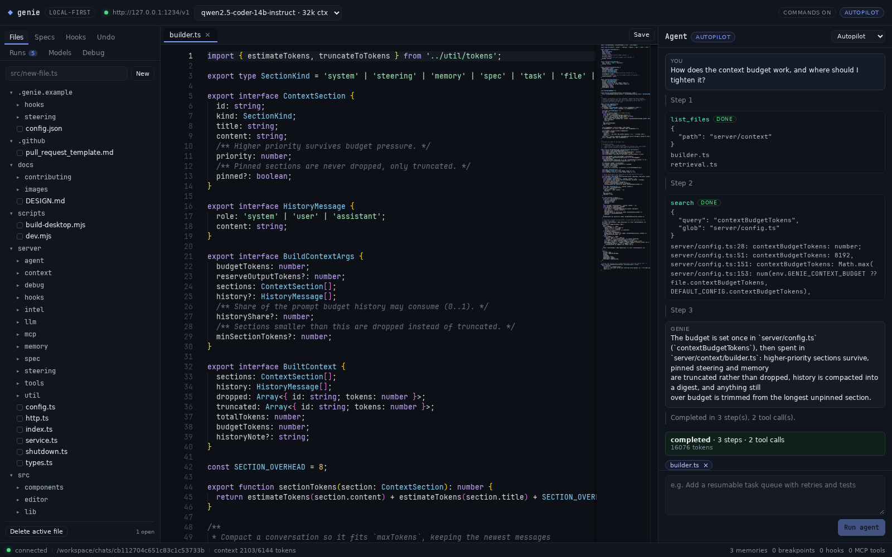
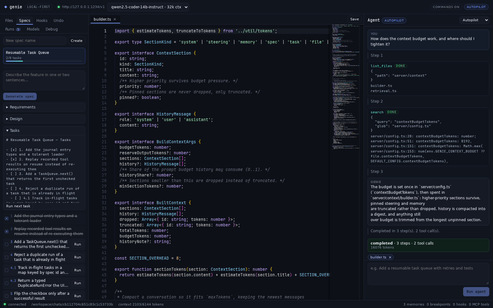
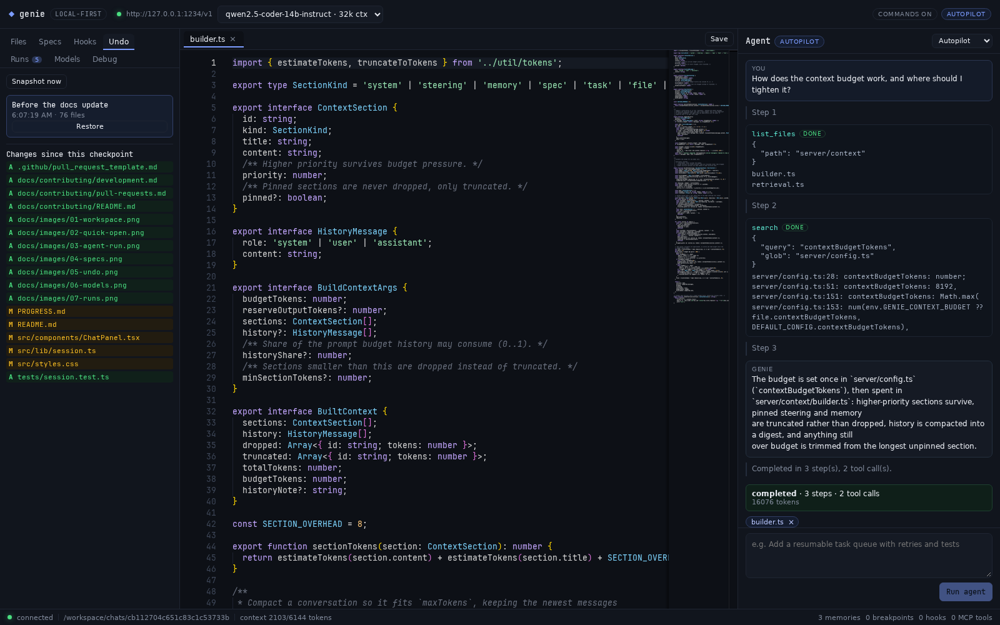
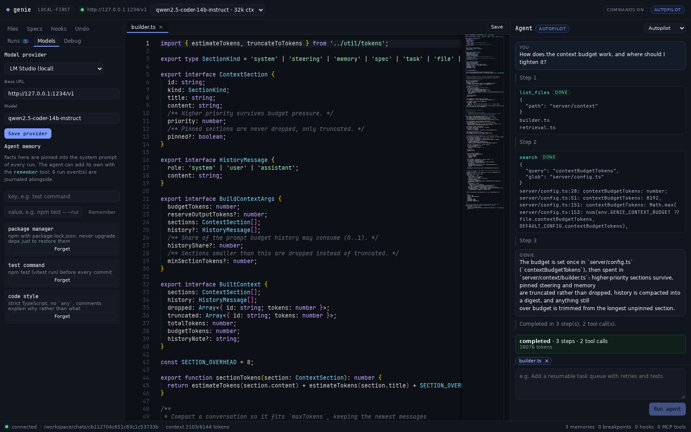
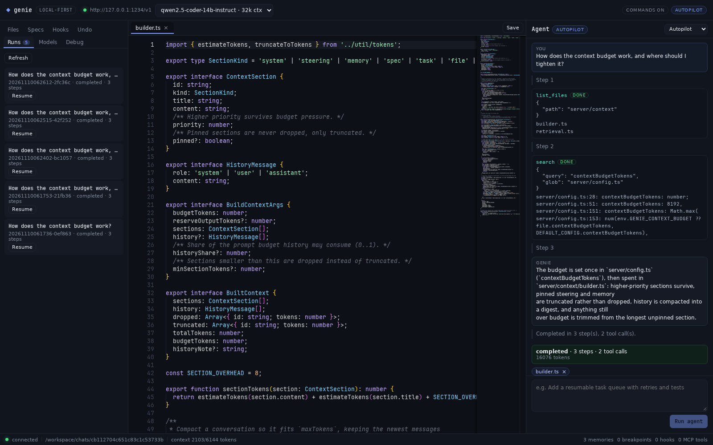

# genie

A local-first, spec-driven agentic IDE in the spirit of Kiro — but every model call goes to
**your own LM Studio server**. No cloud account, no API keys, no telemetry.

```
requirements.md  →  design.md  →  tasks.md  →  agent executes task-by-task
```

## Why it exists

Kiro's value is not the text editor; it is the workflow around the model: a spec that forces
requirements before code, hooks that automate the boring parts, steering files that keep the
model aligned with your conventions, checkpoints you can roll back, and an agent loop that
does not fall over when one run goes wrong. `genie` implements that workflow against a local
OpenAI-compatible endpoint.

## Feature map

| Capability | Status | Where |
| --- | --- | --- |
| Spec generation (requirements → design → tasks) | ✅ | `server/spec/generator.ts` |
| Task-by-task execution with checkbox tracking | ✅ | `server/service.ts`, `server/spec/spec.ts` |
| LM Studio models (list, switch, context length) | ✅ | `server/llm/client.ts` |
| External OpenAI-compatible APIs (optional) | ✅ | `server/config.ts`, `server/llm/client.ts` |
| Streaming chat + streaming agent events (SSE) | ✅ | `server/llm/client.ts`, `server/index.ts` |
| Tool use: read, write, patch, list, search, run | ✅ | `server/tools/index.ts` |
| Resumable runs after a crash or cancel | ✅ | `server/agent/journal.ts`, `server/agent/loop.ts` |
| Self-healing: retry, backoff, context shrink, repair loop | ✅ | `server/agent/loop.ts`, `server/llm/retry.ts` |
| Checkpoints + diff + restore before every write | ✅ | `server/agent/checkpoints.ts` |
| Agent hooks (file/task/stop events → agent or shell) | ✅ | `server/hooks/hooks.ts` |
| Steering files (`always` / `auto` / `manual`) | ✅ | `server/steering/steering.ts` |
| MCP client (stdio, tools/list, tools/call) | ✅ | `server/mcp/client.ts` |
| Context budgeting, history compaction, retrieval | ✅ | `server/context/*` |
| Agent memory: pinned facts + run journal | ✅ | `server/memory/*` |
| Desktop executables (Linux, macOS, Windows) | ✅ | `scripts/build-desktop.mjs` |
| Debugger: breakpoints, stepping, locals, evaluate | ✅ | `server/debug/session.ts`, `src/components/DebugPanel.tsx` |
| Peek definition/usages, hover, outline, diagnostics | ✅ | `src/editor/intel.ts` (Monaco TS service) |
| Autopilot vs supervised tool approval | ✅ | `server/agent/loop.ts` |
| Quick open (Ctrl/Cmd+P), per-file editor state, unsaved-close guard | ✅ | `src/components/QuickOpen.tsx`, `src/App.tsx` |
| Local Monaco editor with bundled workers (works offline) | ✅ | `src/monaco-setup.ts` |
| LSP, debugger, extension marketplace, inline ghost text | ❌ | out of scope (needs Code OSS fork) |

Full parity notes and known gaps: [docs/DESIGN.md](docs/DESIGN.md). Build status:
[PROGRESS.md](PROGRESS.md).

## Requirements

- Node.js 20 or newer (tested on 24)
- [LM Studio](https://lmstudio.ai) with a tool-calling capable model (e.g. Qwen2.5-Coder,
  Llama 3.1/3.3 Instruct, Devstral)

## Quick start

```bash
npm install

# 1. In LM Studio: load a model, then start the local server (default port 1234).

# 2. Point genie at it (defaults already match LM Studio).
cp .genie.example/config.json .genie/config.json        # optional, edit model id
mkdir -p .genie/hooks .genie/steering
cp -r .genie.example/hooks/* .genie/hooks/              # optional
cp -r .genie.example/steering/* .genie/steering/        # optional

# 3. Run it
npm run dev        # API on :8787, UI on :5173
```

Open <http://127.0.0.1:5173>. The status bar shows whether LM Studio is reachable; the model
dropdown is populated from `GET /v1/models`.

Production mode (single process serving the built UI):

```bash
npm run build
npm start          # http://127.0.0.1:8787
```

### Desktop app

Build standalone executables that bundle the server *and* the UI, so the target machine needs no
Node install:

```bash
npm run build-desktop     # typecheck + vite build + three binaries in pkg-out/genie/
./pkg-out/genie/genie-ide-linux-x64
```

One `pkg` run produces `genie-ide-linux-x64`, `genie-ide-macos-arm64` and
`genie-ide-win-x64.exe`. The binary serves the app on <http://127.0.0.1:8787> and opens your default
browser at it, so a double-click behaves like an app; set `GENIE_NO_OPEN=1` to keep it headless for
servers and CI. The macOS binary is cross-built and unsigned, so run
`codesign --sign - pkg-out/genie/genie-ide-macos-arm64` before launching it there.

`GENIE_DESKTOP_TARGETS=node24-linux-x64` narrows the build, `GENIE_DESKTOP_SKIP_PKG=1` stops after
staging the bundle (useful in CI), and `GENIE_PORT` / `GENIE_WORKSPACE` behave as they do in dev.

### Using a different host/port for LM Studio

`.genie/config.json`:

```json
{ "lmStudioBaseUrl": "http://192.168.1.20:1234/v1", "model": "qwen2.5-coder-14b-instruct" }
```

or environment variables: `LMSTUDIO_BASE_URL`, `GENIE_MODEL`, `GENIE_CONTEXT_BUDGET`,
`GENIE_AUTONOMY=supervised`, `GENIE_MAX_STEPS`, `GENIE_MAX_ATTEMPTS`, `GENIE_ALLOW_COMMANDS`.

### Using an external model API (optional)

Local models stay the default, but any OpenAI-compatible API can be used instead — handy when one
task needs more reasoning than your machine can serve. Set it in the **Models** tab, or in
`.genie/config.json`:

```json
{
  "provider": "external",
  "externalBaseUrl": "https://api.openai.com/v1",
  "externalModel": "gpt-4o-mini",
  "externalApiKey": "sk-…"
}
```

Environment equivalents: `GENIE_PROVIDER=external`, `GENIE_EXTERNAL_BASE_URL`,
`GENIE_EXTERNAL_MODEL`, `GENIE_EXTERNAL_API_KEY`. The client only speaks `/chat/completions` with
SSE and tool calls, so OpenAI, Groq, OpenRouter, Together, DeepSeek and self-hosted gateways all
work — you need a base URL, a model name and a key, nothing vendor-specific. `.genie/` is
git-ignored, and `GENIE_EXTERNAL_API_KEY` keeps the key out of any file entirely.

## Debugging and navigation

The editor is wired to real analysis, not name matching:

| Action | Shortcut | Source |
| --- | --- | --- |
| Go to definition | F12 | Monaco TypeScript service |
| Peek definition | Alt+F12 | same result, in the peek widget |
| Find usages (peek) | Shift+F12 | same |
| Go to implementation | Ctrl/Cmd+F12 | same |
| Quick info / hover | hover | same |
| File outline | Ctrl/Cmd+Shift+O | same |
| Problems | inline squiggles | same |

`GET /api/intel/sources` hands the workspace's JS/TS files to Monaco's bundled TypeScript
service, so symbols resolve across files. The bundle is capped (600 files, 3 MB total, 400 KB per
file) and reports `truncated` when it stops early.

The **Debug** tab runs a real Node debugger over the inspector protocol:

- click the gutter (or press F9) to toggle a breakpoint; breakpoints survive reloads
- Debug/Stop, continue, pause, step over / into / out
- call stack with clickable frames, per-scope locals, console + stdout/stderr
- evaluate any expression in the paused frame

Scripts start under `node --inspect-brk`: `.js` works out of the box, `.ts` uses Node 23.6+ type
stripping (or `--experimental-strip-types` on 22.x). The debugger is Node-only — there is no DAP
adapter layer for Python, Go or browser targets, and source maps are not applied.

## Using the app

The screenshots below are captured from the running app with this repository as the workspace. The
demo run used a small local OpenAI-compatible stub endpoint (no cloud calls, no API key), so the
model's wording is canned; everything else — tools, journal, checkpoints, transcript — is real.

### 1. Open a workspace and a file



The status bar tells you whether the model endpoint answers, which workspace is open, and how much
of the context budget the last prompt used. Tick the checkbox beside a file to pin it to the agent's
context without opening it.

### 2. Jump to any file with Ctrl/Cmd+P



Type a few characters of the path; `↑`/`↓` moves, `Enter` opens, `Esc` closes. Tabs keep their own
undo history, cursor and scroll position when you switch between them.

### 3. Ask the agent



Describe a goal and press **Run agent** (or Ctrl/Cmd+Enter). Every step is shown as it happens:
the model's text, each tool call with its arguments and result, self-heal notices, and the final
result with step and tool-call counts. **Autopilot** edits immediately; **Supervised** asks before
each tool call. A write is always preceded by a checkpoint, so nothing is lost.

### 4. Specs: requirements → design → tasks



Create a spec, describe the feature, and hit **Generate spec**. You get `requirements.md`,
`design.md` and `tasks.md` in `.genie/specs/<id>/` — plain markdown you can edit, which the agent
treats as high-priority context. **Run next task** implements the first unchecked task and checks
it off only when the run succeeds; **Run** on a row implements just that task.

### 5. Undo: diff and restore



A snapshot is taken before every mutating tool call, and you can take one by hand with
**Snapshot now**. Open a checkpoint to see which files differ, then **Restore** to put the workspace
back — including deleting files that did not exist yet.

### 6. Models and memory



Switch between LM Studio and any external OpenAI-compatible API without editing files. Facts under
*Agent memory* are pinned into every prompt (the agent also writes its own with the `remember`
tool), which is how conventions survive across runs and restarts.

### 7. Runs never lose finished work



Every run is journaled under `.genie/runs/<id>/journal.jsonl`. **Resume** continues an interrupted
run from its last completed step instead of replaying the tools it already ran.

### Keyboard shortcuts

| Shortcut | Action |
| --- | --- |
| Ctrl/Cmd+P | Quick open: jump to any file in the workspace |
| Ctrl/Cmd+S | Save the active file |
| Ctrl/Cmd+Enter | Run the agent on the current goal |
| F9 | Toggle a breakpoint on the current line |
| F12 / Alt+F12 / Shift+F12 | Go to / peek definition, find usages |
| Ctrl/Cmd+Shift+O | File outline |

## How the self-healing works

| Failure | Behaviour |
| --- | --- |
| LM Studio 5xx / 429 / socket error | Exponential backoff + jitter, up to `maxAttempts`, then a circuit breaker fails fast |
| Tokens already streamed | Never retried, so output is not duplicated |
| Prompt exceeds the context window | Context is trimmed to 40%, the budget shrinks, the same step retries (max 3) |
| Tool returns an error | The error is fed back to the model with a repair budget (`maxToolRepairs`) |
| Tool arguments are not JSON | Rejected with a precise message instead of crashing the step |
| Model emits a tool call as fenced JSON | Rescued into a real tool call |
| Process crash / cancel | Step and tool results are fsync'd to `journal.jsonl`; resume skips finished work |
| Agent run fails | Status is `failed` with `resumable: true`, never a silent partial success |

## Repository layout

```
server/
  agent/        loop.ts (the agent), journal.ts (durability), checkpoints.ts, patch.ts, prompts.ts
  context/      builder.ts (budgeting), retrieval.ts (lexical search)
  llm/          client.ts (LM Studio or any OpenAI-compatible API), retry.ts, structured.ts
  memory/       store.ts (facts.jsonl, core.md, events.jsonl)
  intel/        sources.ts (workspace bundle for the language service)
  debug/        session.ts (Node inspector debugger over CDP)
  tools/        sandboxed file/shell tools
  spec/         spec store + three-stage generator
  hooks/        event → action engine
  steering/     project convention files
  mcp/          minimal stdio MCP client
  service.ts    orchestration
  http.ts       HTTP + SSE API (single router, shared by dev and desktop)
  index.ts      dev entrypoint; boots http.ts
scripts/        dev.mjs, build-desktop.mjs
src/            React + Monaco UI (src/editor/intel.ts wires the TS service)
tests/          vitest suite (122 tests)
docs/DESIGN.md  detailed design
docs/contributing/  setup, architecture notes and the pull-request guide
docs/images/    screenshots used by this README
.github/        pull request template
PROGRESS.md     what is done, what is not
```

## Tests

```bash
npm test          # vitest run
npm run typecheck # tsc --noEmit
npm run build     # typecheck + vite production build
```

The suite covers retry/backoff/circuit breaking, token budgeting invariants, history
compaction, patch atomicity, path-escape rejection (including symlinks), journal durability with
torn writes, checkpoint restore, hook dispatch isolation, spec task parsing, LM Studio SSE
streaming and tool-call assembly, agent resume without replaying tools, context-overflow
healing, MCP stdio round-trips, agent memory (fact dedup, core line cap, event pruning), provider
resolution, the SSE transcript reducer (wrapped agent events vs unwrapped results), and two live
HTTP integration tests against a temp workspace: one for the API surface,
and one that drives a stub OpenAI-compatible server and asserts against the actual request bodies
that completions reach the configured provider with its key and that stored facts reach the prompt.

## Contributing

Setup, architecture notes and the full pull-request flow live in
[docs/contributing](docs/contributing/README.md): start with
[development.md](docs/contributing/development.md) for the dev loop, then
[pull-requests.md](docs/contributing/pull-requests.md) for branching, commits, the review checklist
and what to do when a branch falls behind. The short version:

```bash
npm ci && npm run dev     # work
npm test && npm run typecheck && npm run build   # gates
```

No LM Studio is needed to run the tests or build; one concern per pull request, a regression test
with every fix, and no secrets or `.genie/` state in the diff.

## Safety

- The API binds to `127.0.0.1` by default; it is meant to run on your machine.
- All file paths are resolved inside the workspace; `..`, absolute paths and escaping symlinks
  are rejected.
- Shell commands run only when `allowCommands` is true, with a timeout, and destructive
  patterns (`git push`, `git reset --hard`, `rm -rf /`, `sudo`, piping downloads into a shell)
  are blocked. The agent cannot push your code.
- Checkpoints are taken before writes, so an unwanted edit can be reverted from the UI.
